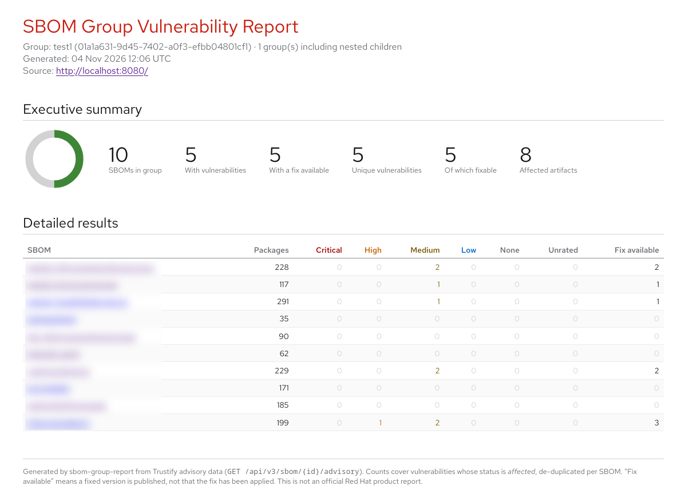

# sbom-group-report

Renders a single vulnerability report, as HTML or CSV, covering every SBOM in
a Trustify SBOM group, including the SBOMs of its nested child groups.



This is a standalone crate: it is not a member of the Trustify workspace and
has its own `Cargo.lock`. It talks to a running Trustify over the REST API
using the [`trustify-client`](https://crates.io/crates/trustify-client) crate
and is read-only.

Requires Rust 1.88 or newer. Run the commands below from this directory
(`tools/sbom-group-report`), not the Trustify workspace root.

## Usage

The group is given as either its ID or its name:

```sh
cargo run -- 4f0e… -o report.html                  # by ID
cargo run -- "acme prod" -o report.html            # by name
cargo run -- "acme prod" -f csv -o report.csv      # detail table as CSV
```

Group names are only unique within their parent, so an ambiguous name is
rejected with the IDs of the candidates. IDs take precedence over names.

Without `-o` the report goes to stdout, so it can be piped.

| Option | Default | Purpose |
| --- | --- | --- |
| `--url`, `TRUSTIFY_URL` | `http://localhost:8080` | Trustify base URL |
| `-f`, `--format` | `html` | `html` for the full report, `csv` for the detail table |
| `-o`, `--output` | stdout | File to write the report to |
| `--max-depth` | 16 | Fail if the subtree exceeds this depth; never silently omit descendants |
| `--concurrency` | 8 | SBOMs queried for advisories at a time |
| `--max-sboms` | 2000 | Stop collection when the subtree exceeds this many distinct SBOMs |
| `--insecure` | off | Allow credentials to reach a non-loopback host over plain HTTP |

Group enumeration has a fixed safety limit of 10,000 groups. Limit failures
produce an error rather than a partial report.

### How the group is walked

The group and every group beneath it are collected breadth-first. An SBOM
assigned to several groups in that subtree appears once. A parent chain that
loops back on itself terminates instead of hanging.

Any failed API call aborts the run with a non-zero exit status and no output.
There is no partial report: a number that appears in the report was read from
the server, never guessed or skipped. Rows are sorted by SBOM name and then by
URL, so two runs over unchanged data produce identical files apart from the
timestamp even when two SBOMs share a name.

Open the HTML in a browser and print to PDF for a shareable document. The CSV
carries the detail table only — the same rows and columns, for pivoting in a
spreadsheet, plus an `SBOM URL` column. HTML SBOM names and CSV URLs link back
to `/sboms/<id>?sd%3AactiveTab=vulnerabilities` on `TRUSTIFY_URL`. The HTML header
also links to that instance. HTML links open in a new browser tab.

SBOM names are quoted per RFC 4180 and a leading `=`, `+`, `-` or `@` —
including behind whitespace a spreadsheet would trim — is prefixed with an
apostrophe, so a hostile SBOM name cannot run as a spreadsheet formula.

The HTML carries its own provenance: the source instance, the group name and
ID, the number of groups walked, a UTC generation timestamp, and a footer
stating it is not an official Red Hat product report. The CSV has none of
this — it is the bare table, so record the context alongside it when sharing.

### Authentication

The server address comes from `TRUSTIFY_URL` (or `--url`):

```sh
export TRUSTIFY_URL="http://localhost:8080"
```

Requests are anonymous unless you configure one of the two options. Secrets
are read from the environment only — never from flags, which any other user on
the host can read out of the process arguments.

A ready-made bearer token, which wins if both are set:

```sh
export TRUSTIFY_TOKEN=...   # without the "Bearer " prefix
```

Or OIDC `client_credentials`, where the tool discovers the issuer's token
endpoint and refreshes the token as the run goes on:

```sh
export TRUSTIFY_URL="http://localhost:8080"
export ISSUER_URL="http://localhost:8090/realms/trustify"
export CLIENT_ID="report-user"
export CLIENT_SECRET="..."
```

All three OIDC variables are required together. `--issuer-url` and
`--client-id` are the equivalent flags; the secret has none.

Discovery must return the configured issuer. Token authentication uses
`client_secret_basic` or `client_secret_post`, as advertised by the issuer;
omitting the supported-methods field defaults to Basic. Tokens are cached
and refreshed before expiry, and invalid lifetimes fail without a panic.
The OIDC URLs carry the client secret, so they must use HTTPS except on
loopback addresses such as `localhost`, and an HTTPS issuer cannot advertise an
HTTP token endpoint. `TRUSTIFY_URL` may be plain HTTP for anonymous runs and
for loopback addresses such as `localhost`. Sending credentials to any other
host over plain HTTP is refused unless you pass `--insecure`, which is for
in-cluster deployments where the network itself is the trust boundary.

### Required permissions

The tool only reads. Three endpoints are called, needing these permissions:

| Endpoint | Permission |
| --- | --- |
| `GET /api/v3/group/sbom` | `read.sbomGroup` |
| `GET /api/v3/sbom` | `read.sbom` |
| `GET /api/v3/sbom/{id}/advisory` | `read.sbom`, `read.advisory` |

Grant a reporting client those three and nothing else.

## What it reports

**Executive summary** — SBOMs in the group, how many have vulnerabilities, how
many have a fix available, unique vulnerabilities, how many of those are
fixable, and the number of distinct affected artifacts.

**Detailed results** — one row per SBOM: name, package count, vulnerability
counts by severity (Critical / High / Medium / Low / None / Unrated), and how
many of its vulnerabilities have a published fix.

Every figure comes from `GET /api/v3/sbom/{id}/advisory`, the pre-correlation
advisory endpoint, so the summary and the table always agree. Only statuses of
`affected` are counted, de-duplicated per SBOM by vulnerability identifier and
keeping the worst severity. *Unrated* means the vulnerability carries no CVSS
score. *Fix available* means a fixed version is published, not that it has
been applied.

Affected artifacts are distinguished by PURL where available, otherwise by
their group/namespace, name, and version.

### Known limits

- The pre-correlation endpoint is deprecated upstream in favour of
  `GET /api/v3/correlation/sbom/{id}`. Migrating will require adapting retrieval
  and mapping its responses into the report model.
- No ecosystem (Java / Python) breakdown: Trustify exposes purl types only via
  a per-SBOM package query, which would roughly triple the request count.
- Group membership is resolved client-side, because Trustify's `group=` filter
  matches direct assignments only. That costs one request per group in the
  subtree, plus one per SBOM for its advisories.
- Inventories are read with offset pagination, ordered by ID so pages are
  stable. Trustify has no snapshot or cursor paging, so an SBOM or group
  added or removed mid-run can still be missed. Report a quiet system.
- *Fix available* comes from the advisory endpoint, which reports fixed
  versions per base PURL. A vulnerability fixed for one affected package but
  not another may be reported as unfixable.
- The CSV carries no timestamp or source instance; only the HTML is
  self-describing.
- There is no progress output, so a large group looks idle until it finishes.
- Not wired into Trustify CI: run the commands under
  [Development](#development) by hand before committing.

## Development

```sh
cargo fmt --all
cargo nextest run --locked

# the same clippy gate the Trustify root uses
cargo clippy --all-targets --all-features -- -D warnings \
  -D clippy::unwrap_used -D clippy::expect_used -D clippy::panic \
  -D clippy::todo -D clippy::unimplemented
```

The tests run the built binary against a local stub HTTP server, so they need
no Trustify instance and no network.
